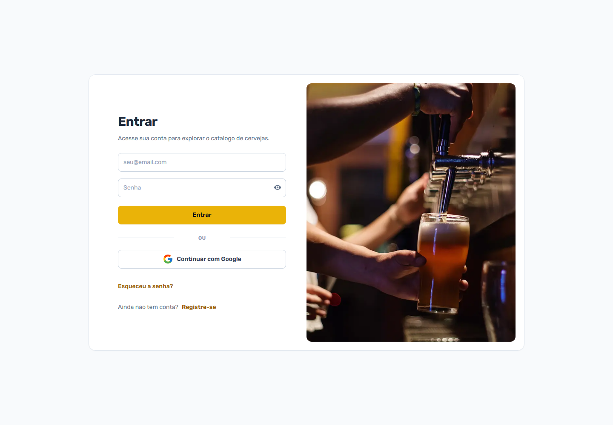
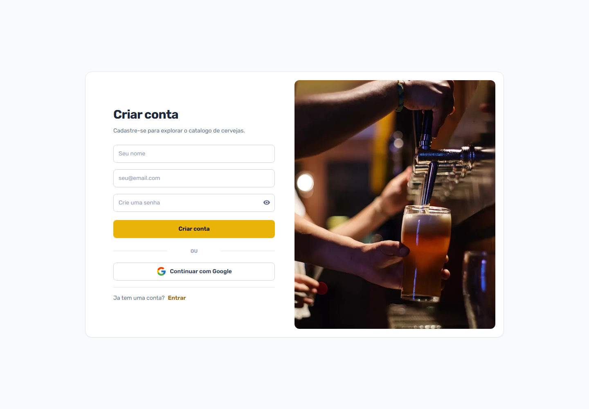
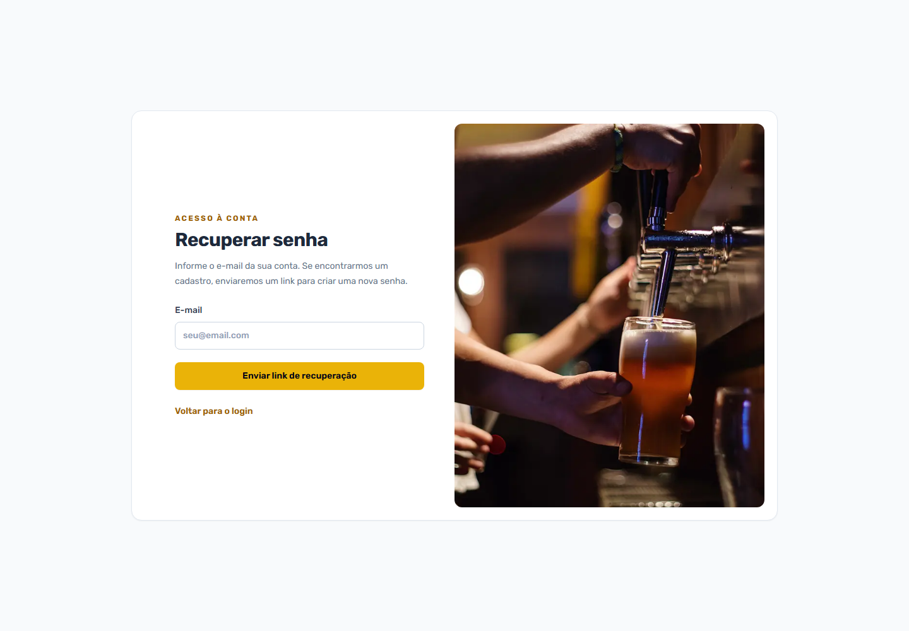
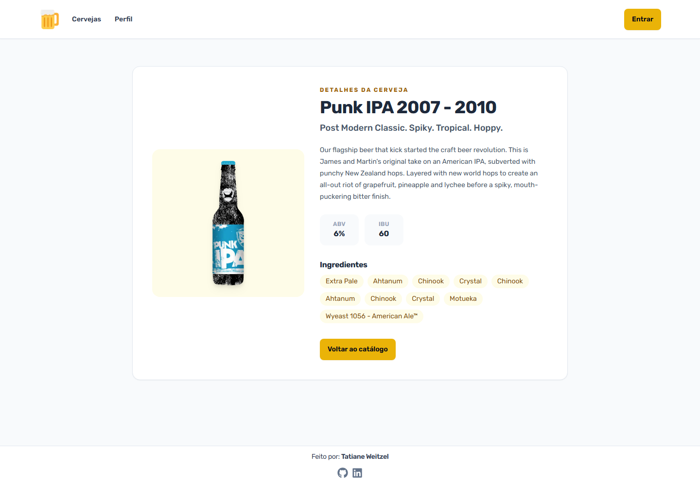

# Catálogo de Cervejas

Aplicação web para explorar cervejas da Punk API, pesquisar e filtrar o catálogo, consultar detalhes e salvar favoritos na conta do usuário.

## Funcionalidades

- Catálogo paginado com busca por nome.
- Filtros por ABV, IBU, favoritos e ordenação.
- Página de detalhes com descrição, ingredientes e informações da cerveja.
- Cadastro e login com e-mail/senha, além de login com Google.
- Recuperação de senha por e-mail, com link de uso único válido por 30 minutos.
- Perfil de usuário e lista de cervejas favoritas.
- Validação dos dados no servidor e limite de tentativas de cadastro/login armazenado no MongoDB.

## Telas do sistema

 ### Login 
  

### Cadastro 
  

### Recuperar senha 

 

### Detalhes da cerveja 
 

## Tecnologias

- Next.js 16 com App Router e React 19.
- TypeScript e Tailwind CSS.
- NextAuth.js 4 para autenticação.
- Prisma 6 e MongoDB Atlas.
- Punk API v3: <https://punkapi.dev/api/v3/beers>.

## Requisitos

- Node.js compatível com a faixa declarada em `package.json`: `^20.19.0`, `^22.13.0` ou `>=24.0.0`.
- npm.
- Banco MongoDB Atlas acessível pela máquina ou pelo ambiente de execução.
- Credenciais OAuth do Google, usadas pelo provedor de login Google configurado no app.

Node 24 LTS é a opção recomendada para um ambiente novo. O Node 20 entrou em fim de suporte em março de 2026; use-o apenas se precisar manter essa linha por compatibilidade. Consulte o [status das versões Node.js](https://nodejs.org/en/about/previous-releases).

## Configuração local

1. Clone o repositório e entre na pasta do projeto.
2. Instale as dependências usando o lockfile:

   ```bash
   npm ci
   ```

3. Crie um arquivo `.env` na raiz do projeto com as variáveis abaixo:

   ```dotenv
   DATABASE_URL="mongodb+srv://<usuario>:<senha>@<cluster>.mongodb.net/<nome-do-banco>?retryWrites=true&w=majority"
   NEXTAUTH_URL="http://localhost:3000"
   NEXTAUTH_SECRET="<segredo-aleatorio>"
   GOOGLE_CLIENT_ID="<client-id-do-google>"
   GOOGLE_CLIENT_SECRET="<client-secret-do-google>"
   SMTP_HOST="<servidor-smtp>"
   SMTP_PORT="587"
   SMTP_USER="<usuario-smtp>"
   SMTP_PASSWORD="<senha-ou-token-smtp>"
   SMTP_FROM="Cervejas <no-reply@seudominio.com>"
   # Opcional; se omitida, a aplicação usa a Punk API v3.
   API_URL="https://punkapi.dev/api/v3/beers"
   ```

   Na `DATABASE_URL`, informe o nome do banco depois de `.mongodb.net/`. Se a senha tiver caracteres especiais, codifique-os para URL. Gere um segredo para o NextAuth com:

   ```bash
   node -e "console.log(require('crypto').randomBytes(32).toString('base64'))"
   ```

   Não compartilhe nem envie o `.env` para o Git. O projeto já ignora arquivos `.env*`.

   Configure as variáveis SMTP com os dados do provedor de e-mail escolhido. Use a porta 465 para TLS direto ou 587 para STARTTLS; o remetente em `SMTP_FROM` deve estar autorizado pelo provedor. Sem essas variáveis, o formulário continua respondendo de forma genérica, mas o envio de e-mail não será concluído.

4. No Google Cloud, cadastre o URI de redirecionamento autorizado para desenvolvimento:

   ```text
   http://localhost:3000/api/auth/callback/google
   ```

   Em produção, cadastre também o callback com o domínio público da aplicação. Veja a [documentação do provedor Google do NextAuth](https://next-auth.js.org/providers/google).

5. Sincronize o schema Prisma com o banco e gere o Prisma Client:

   ```bash
   npx prisma db push
   npx prisma generate
   ```

   O Prisma usa `db push` para sincronizar o schema com MongoDB; o fluxo de migrations do Prisma não é usado para esse banco. Revise qualquer alteração proposta pelo comando antes de aplicá-la em um banco que já contenha dados.

6. Inicie o servidor de desenvolvimento:

   ```bash
   npm run dev
   ```

   Acesse <http://localhost:3000>.

## Deploy na Vercel

1. Envie o projeto para um repositório Git e, no painel da Vercel, crie um projeto importando esse repositório. A Vercel detecta o Next.js; mantenha a pasta raiz do projeto como diretório raiz.
2. Em **Settings → Build and Deployment**, selecione Node.js `24.x`, compatível com a faixa declarada em `package.json`. A Vercel usa a versão selecionada para novos deploys; consulte [versões do Node.js na Vercel](https://vercel.com/docs/functions/runtimes/node-js/node-js-versions).
3. Em **Settings → Environment Variables**, adicione as variáveis de produção abaixo. Marque o ambiente **Production**; configure **Preview** somente se tiver credenciais e banco separados para testes.

   ```text
   DATABASE_URL
   NEXTAUTH_URL
   NEXTAUTH_SECRET
   GOOGLE_CLIENT_ID
   GOOGLE_CLIENT_SECRET
   SMTP_HOST
   SMTP_PORT
   SMTP_USER
   SMTP_PASSWORD
   SMTP_FROM
   API_URL (opcional)
   ```

   Use a URL pública do projeto em `NEXTAUTH_URL`, por exemplo `https://seu-projeto.vercel.app`. Gere um `NEXTAUTH_SECRET` próprio para produção. Cadastre os valores em **Settings → Environment Variables**; não envie o `.env` local ao Git nem reutilize uma `NEXTAUTH_URL` de localhost. Mudanças nas variáveis só entram em vigor em novos deploys. Veja a [documentação de variáveis de ambiente da Vercel](https://vercel.com/docs/environment-variables/managing-environment-variables).

4. No Google Cloud, adicione o URI de redirecionamento OAuth exatamente como abaixo, substituindo pelo domínio público do projeto:

   ```text
   https://seu-projeto.vercel.app/api/auth/callback/google
   ```

   Se usar um domínio próprio, cadastre também o callback correspondente a esse domínio. O endereço local `http://localhost:3000/api/auth/callback/google` continua sendo usado apenas no desenvolvimento.

5. Antes do primeiro deploy com este schema, sincronize o banco Atlas com o `prisma/schema.prisma` usando `npx prisma db push` a partir de um ambiente que tenha a `DATABASE_URL` correta. Revise as alterações antes de aplicá-las a um banco que já contenha dados. Não é necessário configurar migrations do Prisma para MongoDB.
6. Faça o deploy pelo Git (push para a branch de produção configurada no projeto) ou pela CLI:

   ```bash
   npx vercel login
   npx vercel link
   npx vercel deploy --prod
   ```

   Para usar a CLI, autentique-se na sua conta e vincule a pasta ao projeto Vercel. Consulte [deploy pela CLI](https://vercel.com/docs/projects/deploy-from-cli). Se alterar variáveis depois, crie um novo deploy para aplicá-las.

7. Depois do deploy, teste a abertura do catálogo, o login com Google e o envio do e-mail de recuperação. Se o Atlas bloquear conexões externas, ajuste a configuração de acesso de rede do cluster para permitir as funções da Vercel sem expor credenciais no repositório.

## Comandos úteis

```bash
npm run dev       # servidor de desenvolvimento
npm run lint      # verifica o código com ESLint
npm run build     # cria o build de produção
npm run start     # inicia o build de produção
```

Para visualizar dados MongoDB, use o Atlas Data Explorer ou o MongoDB Compass; o Prisma Studio não oferece suporte ao MongoDB.

## Rotas principais

| Rota               | Descrição                                               |
| ------------------ | ------------------------------------------------------- |
| `/`                | Página inicial                                          |
| `/login`           | Login com e-mail/senha ou Google                        |
| `/forgot-password` | Solicitar link de recuperação ou definir uma nova senha |
| `/register`        | Cadastro de conta                                       |
| `/beer`            | Catálogo, busca, filtros e favoritos; exige login       |
| `/beer/[id]`       | Detalhes de uma cerveja                                 |
| `/profile`         | Perfil e favoritos do usuário                           |

## Estrutura do projeto

```text
src/app/          Páginas, layouts e rotas de API do Next.js
src/components/   Componentes de interface
src/lib/          Autenticação, Prisma, validação e limite de tentativas
src/services/     Integração com a Punk API
prisma/           Schema do banco MongoDB
public/           Imagens e outros arquivos estáticos
```

## Observações importantes

- O schema do banco está em `prisma/schema.prisma`. Após alterá-lo, sincronize-o com `npx prisma db push` e regenere o cliente com `npx prisma generate`.
- O limite de tentativas usa a coleção `RateLimitBucket`; por isso, o MongoDB precisa estar disponível para cadastro e login.
- A recuperação armazena somente o hash do token no MongoDB. O reset usa uma transação; em produção, use MongoDB Atlas ou uma implantação MongoDB com replica set.
- As URLs de imagens externas permitidas estão configuradas em `next.config.js`.
- Para produção, siga a seção [Deploy na Vercel](#deploy-na-vercel), use um `NEXTAUTH_URL` HTTPS público e mantenha as credenciais fora do repositório.

---

Feito por **Tatiane Weitzel**.
